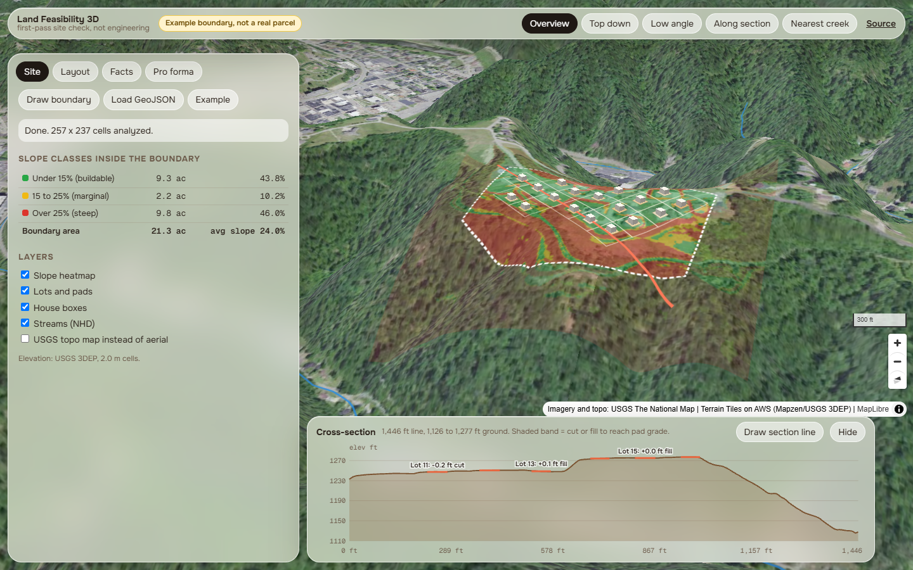
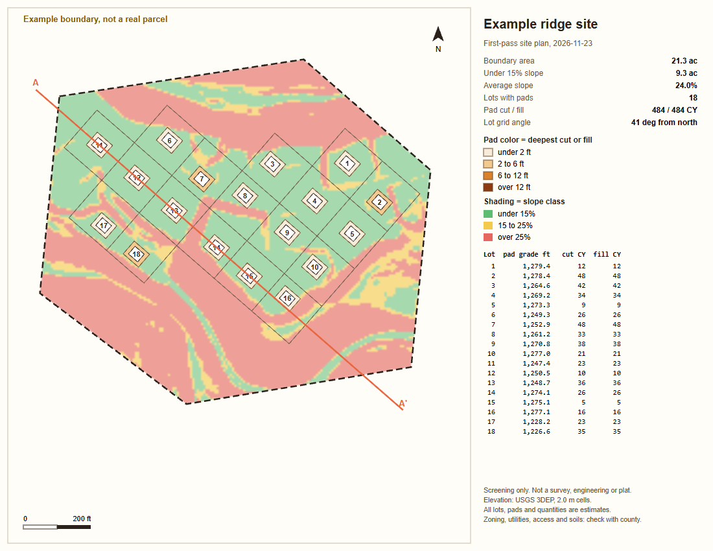
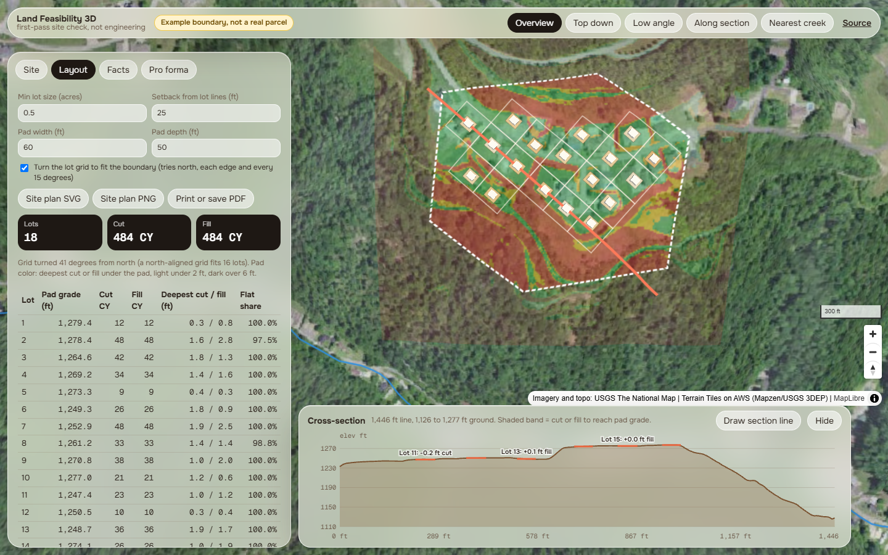
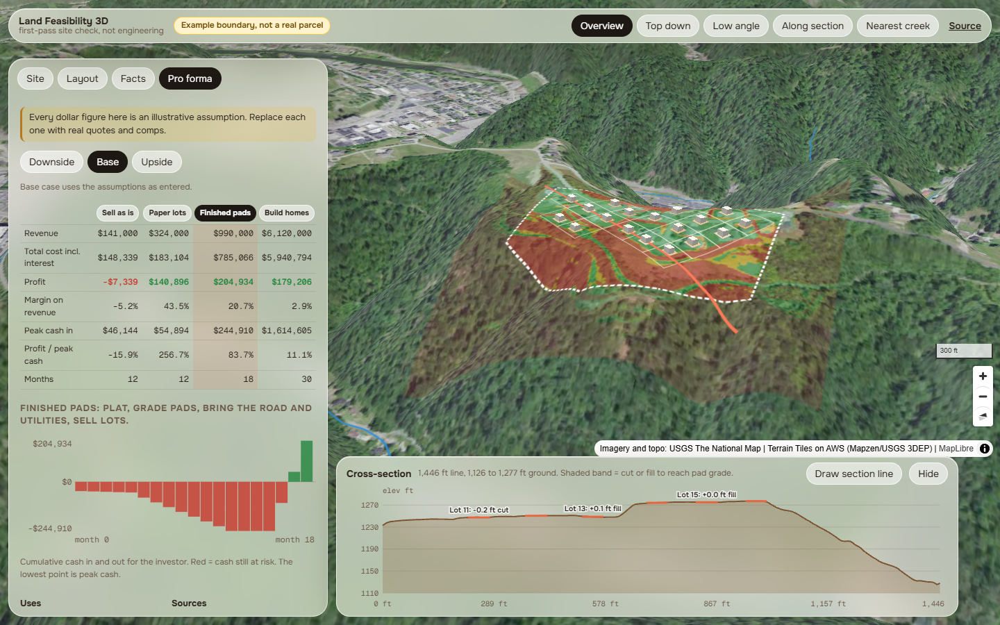
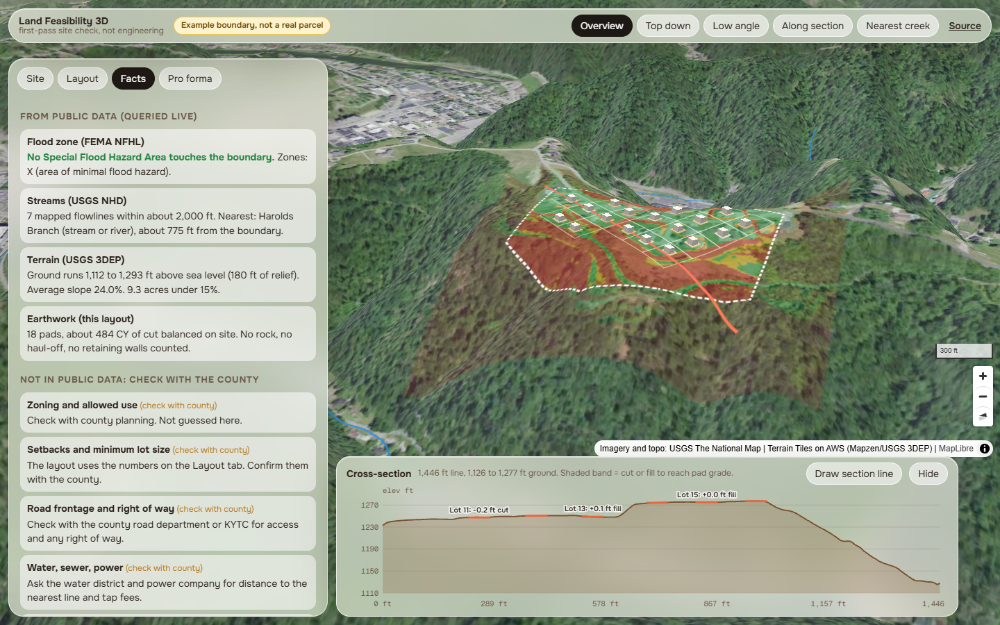

# land-feasibility-3d

[](https://github.com/chasebuilds/land-feasibility-3d/actions/workflows/ci.yml)
[](LICENSE)

**Draw a boundary on a map and get a first look at a hillside tract:** how many acres are flat enough to build on, a lot and pad layout, cut and fill per pad, the FEMA flood zone, the nearest stream, a printable site plan, and what four ways out (sell, plat, grade, build) could earn.

**Live demo:** https://chasebuilds.github.io/land-feasibility-3d/ (runs in the browser, no sign-up, no API keys)



**Who it helps:** land buyers screening a tract before paying for a survey, small developers comparing exits, and realtors who want a clear visual for a listing. It is a screening tool, not engineering. The demo opens on an **invented example boundary** near Pikeville, Kentucky, labeled "example boundary, not a real parcel". No owner names or parcel records are used.

**Measured** on synthetic terrain with known answers (`npm run bench`, full table in [BENCHMARK.md](BENCHMARK.md)): slope within 0.13 percentage points at the 99th percentile; balanced-pad cut within 3.9% on average; turning the lot grid to the ridge fit 1,560 lots on 100 test ridges where a north-aligned grid fit 1,275, with 0 lots outside the boundary.

## What it does

| Step | How |
| --- | --- |
| 3D terrain | MapLibre GL JS with terrain and hillshade from AWS Terrain Tiles, over USGS National Map aerial imagery (or USGS topo). No API keys. |
| Elevation for analysis | USGS 3DEP Elevation ImageServer `exportImage` for the boundary plus 80 m, at about 2 m cells (LiDAR-derived where 3DEP has it). If 3DEP fails twice, it falls back to AWS Terrain Tiles (terrarium PNG) resampled to the same grid. The app says which source it used. |
| Slope | Percent slope per cell (Horn 3x3 method) computed in a Web Worker. Classes: under 15% buildable (green), 15 to 25% marginal (yellow), over 25% steep (red). Acres per class inside the boundary. Heatmap draped on the terrain, faded outside the boundary. |
| Layout | Square lots of the minimum size (default 0.5 acre). The grid is turned to whichever angle fits the most lots: north, each boundary edge direction, and every 15 degrees, with 16 grid offsets at each angle. Turn it off to use a north-aligned grid. A pad (default 60 x 50 ft) goes in only where 90% of it is under 15% slope, keeping the setback (default 25 ft) from every lot line. House boxes are drawn in 3D on each pad. |
| Cut and fill | Each pad is set at the mean ground elevation under it. Cut and fill are summed cell by cell, each cell weighted so the cells add up to the pad's true area, and reported in cubic yards with the deepest cut and fill in feet. Pads on the map are shaded by their deepest cut or fill (under 2 ft, 2 to 6, 6 to 12, over 12). |
| Cross-section | By default a line along the lot row that holds the most pads, or draw your own. Shows ground vs pad grade with the cut/fill band shaded and "+x ft fill" / "-x ft cut" labels per pad. |
| Site facts | FEMA NFHL flood zones intersecting the boundary and USGS NHD flowlines within about 2,000 ft (nearest named stream and distance), queried live. Elevation range and average slope from the DEM. Zoning, setbacks, road access, utilities, septic, mineral rights and title are shown as "check with county" items, never guessed. A short list of gates to clear before any offer. |
| Site plan export | One click gives a to-scale site plan with north arrow, scale bar, slope shading clipped to the boundary, numbered lots, pads shaded by cut/fill depth, the section line A to A', a lot table and notes. Download as SVG or PNG, or print or save as PDF from the browser. |
| Pro forma | Four exits: sell as is, paper lots, finished pads, build homes. Downside, base and upside cases. Twenty sliders (land price, lot count from the layout, earthwork CY from the layout, cost per CY, site work per lot, build cost per sq ft, sale prices, months, loan to cost, rate, selling costs). Outputs profit, margin, peak cash, profit on peak cash, a monthly cash chart, sources and uses, and per-lot or per-home numbers. If sales cannot repay the loan, the shortfall is shown and paid from equity at the end. |

Every dollar figure is an illustrative starting assumption, labeled as such in the app. Replace each one with real quotes and comps.

### The example run

For the invented ridge boundary, with the default inputs, the app reported (USGS 3DEP, 2.0 m cells, run 2026-11-23):

- 21.3 acres inside the boundary: 9.3 ac under 15%, 2.2 ac at 15 to 25%, 9.8 ac over 25%. Average slope 24.0%.
- Ground from 1,112 to 1,293 ft (180 ft of relief).
- 18 half-acre lots with pads on a grid turned 41 degrees (a north-aligned grid fits 16), 484 CY of cut balanced by 484 CY of fill.
- FEMA NFHL: zone X (minimal flood hazard) only. Nearest NHD stream: Harolds Branch, about 775 ft from the boundary.

These are computed from public data for a made-up boundary. They describe nothing about any real property.









## Run it

```bash
npm ci
npm run dev      # local dev server
npm test         # Vitest unit tests (slope, cut/fill, layout, turned grid, site plan, cross-section, pro forma)
npm run bench    # seeded benchmark on synthetic terrain, rewrites BENCHMARK.md
npm run lint     # ESLint
npm run build    # strict type-check and production build
```

## Project layout

| Path | Purpose |
| --- | --- |
| `src/lib/geo.ts` | Web Mercator grid, local meters, point-in-polygon, distances, bilinear sampling |
| `src/lib/slope.ts` | Horn slope, classes, area per class, heatmap colors |
| `src/lib/layout.ts` | Lot and pad packing, turned grid and angle search |
| `src/lib/siteplan.ts` | Standalone SVG site plan |
| `src/lib/earthwork.ts` | Balanced pad cut and fill, area-weighted on the grid |
| `bench/run.ts` | Benchmark that writes BENCHMARK.md |
| `src/lib/section.ts` | Cross-section profile and pad crossings |
| `src/lib/proforma.ts` | Monthly four-exit model with cases and financing |
| `src/dem.ts` | 3DEP GeoTIFF download and terrarium fallback |
| `src/facts.ts` | FEMA NFHL and USGS NHD queries |
| `src/slope.worker.ts` | Slope in a Web Worker |
| `src/main.ts` | Map, drawing, panels, charts |

## Data sources

All keyless and public. Please respect each provider's usage terms.

- **USGS 3D Elevation Program (3DEP)**, Elevation ImageServer: `https://elevation.nationalmap.gov/arcgis/rest/services/3DEPElevation/ImageServer`
- **Terrain Tiles on AWS** (Registry of Open Data, terrarium encoding; built from 3DEP, SRTM and other sources): `https://s3.amazonaws.com/elevation-tiles-prod/terrarium/{z}/{x}/{y}.png`
- **USGS The National Map** basemaps: USGSImageryOnly and USGSTopo tile services
- **FEMA National Flood Hazard Layer**, layer 28 (Flood Hazard Zones): `https://hazards.fema.gov/arcgis/rest/services/public/NFHL/MapServer`
- **USGS National Hydrography Dataset**, layer 6 (Flowline, large scale): `https://hydro.nationalmap.gov/arcgis/rest/services/nhd/MapServer`
- Map rendering: **MapLibre GL JS** (BSD-3). GeoTIFF parsing: **geotiff.js** (MIT).

## Limitations

See [LIMITATIONS.md](LIMITATIONS.md). In short: first-pass screening only, not a survey, engineering or appraisal; DEM resolution limits what it can see; no zoning, utility or soils data.

## License

MIT. See [LICENSE](LICENSE).
